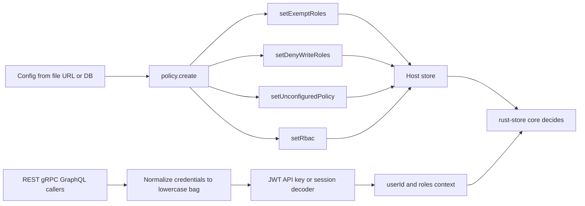

# store-rbac-bootstrap

**An optional bootstrap plugin for the common-store skin layer: it installs one RBAC policy onto the host store and turns each skin's credentials into one `{userId, roles}` context — then leaves every permission decision to the core.**


- Two isomorphic runtimes at **0.2.3**: `store-rbac-bootstrap-node` and `store-rbac-bootstrap-py`.
- Four host facades, three skins, six context hooks — no per-skin authorization code.
- The policy is carried verbatim to rust-store; this package never reads or interprets it.

> Chinese docs: [README.zh-CN.md](./README.zh-CN.md)

## Three doors, three versions of "who is calling"

Suppose a product exposes the same tables through three doors: REST for the browser, GraphQL for mobile, gRPC for internal services. Suppose each door grew its own authorization glue — a token parser here, a metadata reader there, a cookie lookup somewhere else. The same role ends up spelled three ways. A single policy change becomes three pull requests and three deploys. Incident reviews stall on a question nobody can answer with certainty: which door made this call, and which copy of the identity logic did it use?

No dramatic outage is required for the tax to compound. It shows up as four host facades invoked in three different orders, six context hooks with six different signatures, and identity extraction copy-pasted into every new surface. The numbers in this paragraph are structural, not measured: 3 skins × 2 runtimes = 6 hooks, 4 facades, 4 config keys, 2 optional reference tables.

This repository removes the duplication at the edge — and nowhere else. It installs the policy. It produces identity. It does not decide.

## What it actually does

Two mappings, deliberately nothing more:

1. **Policy bootstrap** — read one JSON config, validate it, then call the host store's *existing* RBAC facades in a fixed order: `setExemptRoles`, `setDenyWriteRoles`, `setUnconfiguredPolicy`, and `setRbac` last. Optionally register schema definitions supplied by the integrator; no DDL is triggered.
2. **Identity adaptation** — decode JWT, API key, or cookie session into `{userId, roles}`, then wrap that decoder in the exact hook signature each skin expects.

| It does | It refuses to do |
|---|---|
| Read a bootstrap config and call four existing host facades | Decide whether a caller may read or write a row |
| Register optional schema definitions into the host registry | Create tables or own business schemas |
| Decode JWT / API key / cookie session into `{userId, roles}` | Issue tokens, store users, or authenticate anyone |
| Fill the six existing context seams of REST, GraphQL, gRPC | Invent error codes, status codes, or an admin API |

### Two runtimes, one contract

| Runtime | Package | Install | Import | Minimum |
|---|---|---|---|---|
| Node | `store-rbac-bootstrap-node` | `npm i store-rbac-bootstrap-node` | `require('store-rbac-bootstrap-node')` | Node >= 18 |
| Python | `store-rbac-bootstrap-py` | `pip install store-rbac-bootstrap-py` | `import store_rbac_bootstrap` | Python >= 3.10 |

Both are version **0.2.3** and implement the same protocol from [`spec/00-protocol.md`](./spec/00-protocol.md). Own dependencies are only `jsonwebtoken ^9` (Node) and `PyJWT >= 2.8` (Python). The host store is declared as an **optional peer** (`nodejs-store >= 3.0.0` / `py-store >= 3.0.0`) — there is no runtime dependency on it, because the integrator passes the store instance in.

## Key mechanisms

### 1. Install the policy, validate before touching the store

`policy.create(store, …)` returns a handle with two methods. `start()` runs a sequence that is fixed on purpose:

1. Read the config from the chosen source (`file`, `url`, `db`, or your own function). A read failure propagates unchanged.
2. Validate the envelope. Exactly four top-level keys are allowed; an unknown key, a non-array `exemptRoles`, or an `unconfiguredPolicy` outside `"open"` / `"closed"` throws **before any facade call** — so a bad config can never leave a half-applied state.
3. Register the effective `schemas` set with the synchronous, idempotent `has` / `register` pair. The default is `[]`, which registers nothing.
4. Apply the four facades in strict order, with `setRbac` last so the policy takes effect only after the surrounding lists are in place.

`reload()` calls `setRbac(null)` first — an explicit clear, so no stale grant survives — then reruns the whole sequence. The call is idempotent: with the reference schemas injected, the first `start()` reports `{ registered: ['RbacRole', 'RbacGrant'], skipped: [] }` and a second reports `{ registered: [], skipped: ['RbacRole', 'RbacGrant'] }`. The plugin ships no watcher and no timer: when to reload is your decision.

Ownership of schemas is decoupled. The package ships **no authoritative RBAC schema** and no business schemas. `policy.schemas()` returns two *reference* definitions — `RbacRole` (`__rbac_roles`) and `RbacGrant` (`__rbac_grants`) — deep-copied on each call. They are used only if you inject them, and only to `register` definitions, never to build tables.

### 2. Adapt identity: one bag, two layers, six signatures

Everything is split into a skin-agnostic **decoder** (`bag → ctx`) and a per-skin **adapter** that installs the decoder into an existing seam.

The bag is a flat map with lower-case credential keys; when a header appears more than once, the first string value wins. Each adapter knows where to find that bag:

| Skin | Node bag source | Python bag source |
|---|---|---|
| store-api | `req.headers` | `request.headers` |
| store-grpc | `call.metadata` (supports `getMap`, `forEach`, or iteration) | `invocation_metadata` (pairs or object with `get`) |
| store-graphql | `{ request, serverContext }.request.headers` | `request.headers` |

Three decoders cover the common credential styles. `identity.jwt` verifies signature and expiry for `HS256` / `HS384` / `HS512`, then maps `sub` and `roles` by default. `identity.apiKey` and `identity.session` delegate the credential store to your `lookup` callback, which may be asynchronous; a miss returns `null`, not an empty context.

Because signatures differ across skins *and* across runtimes within a skin, the factory adapts per skin per runtime:

| Skin | Node hook | Python hook |
|---|---|---|
| store-api | `(req) => Promise<ctx \| null>` | `async (request) => ctx \| None` |
| store-grpc | `(metadata) => Promise<ctx \| null>` | `async (invocation_metadata) => ctx \| None` |
| store-graphql | `({ request, serverContext }) => Promise<ctx \| null>` | `async (request) => ctx \| None` |

An unknown skin name throws at construction. There is no "one signature fits all". The built-in decoders always produce either `ctx` or a strict `null` — never a missing return, which would bypass the skin's explicit clear.

### 3. Adjudication stays in the core

The policy object is opaque to this package. Validation covers the four-key envelope only; the shared corpus lists policy-content keys such as `mode`, `grants`, `readFields`, `writeFields`, `ownerOnly`, and `condition` as forbidden in the plugin's logic. The object is handed to `setRbac` untouched.

That is the whole point. rust-store owns the decision — the static whitelists, the dynamic RBAC engine, the `creator` pseudo-role, and the `ownerOnly` row condition. This plugin owns only the inputs: a truthful `userId` and the roles that ride with it. If no `userId` reaches the context, the core's ownership condition is simply false; the plugin never guesses, never fills in a default identity, and never turns a missing credential into an anonymous user.

### 4. Errors: three states, no new vocabulary

The identity layer has exactly three outcomes, identical in both runtimes:

| Situation | Plugin behaviour | What the skin already does |
|---|---|---|
| No credential | Return strict `null` / `None` | Clear the context explicitly |
| Credential present but invalid | Throw a plain `Error` / `ValueError`, message in Chinese, **no `ERR_` prefix** | Map to 401 or `UNAUTHENTICATED` |
| `lookup` throws a host permission class | Propagate as-is — no `instanceof` check, no wrapping | Map to 403 or `PERMISSION_DENIED` |

The adjudication layer has its own three states, and this plugin sits outside that path. A write probe that matches no row returns `ERR_NOT_FOUND` — deliberately not a permission error, because "deleted" and "not yours" need different answers. A row that exists but may not be touched keeps the core's original permission wording instead of being re-wrapped. Since the plugin never sees a query result, it has no interception point: what the skin maps is what the caller gets, with no vocabulary added in between.

## Running it

```bash
# Node
npm i store-rbac-bootstrap-node
npm i nodejs-store                  # optional peer, supplied as the host store

# Python
pip install store-rbac-bootstrap-py
pip install py-store                # optional peer, supplied as the host store
```

The Node fragment below mirrors assertions in `node/test/policy.test.js` (T1) and `node/test/identity.test.js` (T12). It runs as-is after the install above; the store is an in-memory recorder so nothing external is needed.

```javascript
const jwt = require('jsonwebtoken');
const { policy, identity } = require('store-rbac-bootstrap-node');

const calls = [];
const store = {
  setRbac: (v) => calls.push(['setRbac', v]),
  setExemptRoles: (v) => calls.push(['setExemptRoles', v]),
  setDenyWriteRoles: (v) => calls.push(['setDenyWriteRoles', v]),
  setUnconfiguredPolicy: (v) => calls.push(['setUnconfiguredPolicy', v]),
};

(async () => {
  const config = {
    policy: { mode: 'overlay', roles: {}, grants: [] },
    exemptRoles: ['super_admin'],
    denyWriteRoles: ['guest'],
    unconfiguredPolicy: 'closed',
  };

  const handle = policy.create(store, { source: async () => config });
  await handle.start();
  console.log(calls.map(([name]) => name));
  // ['setExemptRoles', 'setDenyWriteRoles', 'setUnconfiguredPolicy', 'setRbac']

  const decode = identity.jwt({ secret: 'dev-secret-at-least-32-bytes-long!!' });
  const token = jwt.sign({ sub: 'u1', roles: ['editor'] }, 'dev-secret-at-least-32-bytes-long!!');
  console.log(await decode({ authorization: `Bearer ${token}` }));
  // { userId: 'u1', roles: ['editor'] }

  const restHook = identity.adapt('store-api', decode);
  // wire restHook as store-api's contextProvider
})();
```

The Python fragment mirrors `py/tests/test_policy.py` (T1) and `py/tests/test_identity.py` (T12).

```python
import asyncio
import jwt
from store_rbac_bootstrap import policy, identity


class Store:
    def __init__(self):
        self.calls = []

    def set_rbac(self, v):
        self.calls.append(("set_rbac", v))

    def set_exempt_roles(self, v):
        self.calls.append(("set_exempt_roles", v))

    def set_deny_write_roles(self, v):
        self.calls.append(("set_deny_write_roles", v))

    def set_unconfigured_policy(self, v):
        self.calls.append(("set_unconfigured_policy", v))


async def main():
    store = Store()
    config = {
        "policy": {"mode": "overlay", "roles": {}, "grants": []},
        "exemptRoles": ["super_admin"],
        "denyWriteRoles": ["guest"],
        "unconfiguredPolicy": "closed",
    }

    async def source():
        return config

    handle = policy.create(store, source)
    await handle.start()
    print([name for name, _ in store.calls])
    # ['set_exempt_roles', 'set_deny_write_roles', 'set_unconfigured_policy', 'set_rbac']

    decode = identity.jwt(secret="dev-secret-at-least-32-bytes-long!!")
    token = jwt.encode({"sub": "u1", "roles": ["editor"]}, "dev-secret-at-least-32-bytes-long!!", algorithm="HS256")
    print(await decode({"authorization": f"Bearer {token}"}))
    # {'userId': 'u1', 'roles': ['editor']}

    rest_hook = identity.adapt("store-api", decode)
    # pass rest_hook as store-api's context_provider


asyncio.run(main())
```

Both runtimes carry the same 21 mirrored cases (T1–T21) plus a shared corpus at `conformance/cases.json`; neither duplicates the expected values. Run them with `cd node && npm test` and `cd py && pip install -e ".[dev]" && pytest`.

## Boundaries: when not to use it

- **It is not an authorization engine.** It makes no permission decision, has no rejection point, and constructs no permission error. That is rust-store's job, permanently.
- **It is not authentication.** It does not register users, issue tokens, check passwords, or own a credential store. JWT handling stops at signature and expiry; API-key and session handling delegate to your `lookup`. It never decides whether someone may log in.
- **It does not create tables or define business schemas.** `schemas` only registers definitions into the host registry; no DDL runs, and business entities are out of scope.
- **It ships no watcher, timer, or policy admin plane.** You decide when to call `reload()`. The intended admin path is reusing store-api's auto-generated CRUD over schemas you define.
- **It maps no status codes.** 401 / 403 / `UNAUTHENTICATED` / `PERMISSION_DENIED` belong to the skins' existing behaviour.
- **It is unnecessary if you have one skin and one identity source.** A handful of lines of glue is cheaper than a new dependency; this package pays off when the same policy must hold across several surfaces and both runtimes.
- **First-wave exclusions:** the Go skins, `store-api` for Rust, and `store-mcp` in both runtimes (5 hooks) are out of scope for now. "Excluded" is not "unsupported"; the anchors are Go ecosystem maturity and the gateway's fourth switch.

## Where it sits in the family

It occupies the seam between the two host stores and the three protocol skins, borrowing [store-gateway](https://github.com/coenddt/store-gateway)'s shape: read configuration, plug into seams that already exist.

- [rust-store](https://github.com/coenddt/rust-store) — the core that owns the permission decision
- [nodejs-store](https://github.com/coenddt/nodejs-store) · [py-store](https://github.com/coenddt/py-store) — the host stores whose facades are called
- [store-api](https://github.com/coenddt/store-api) · [store-graphql](https://github.com/coenddt/store-graphql) · [store-grpc](https://github.com/coenddt/store-grpc) — the skins whose context seams are filled
- [store-mcp](https://github.com/coenddt/store-mcp) — MCP skin, excluded in this phase

## One picture



The policy enters once on the left. Identity enters once on the right. Every arrow that could have been a per-skin authorization check ends at the same core.
