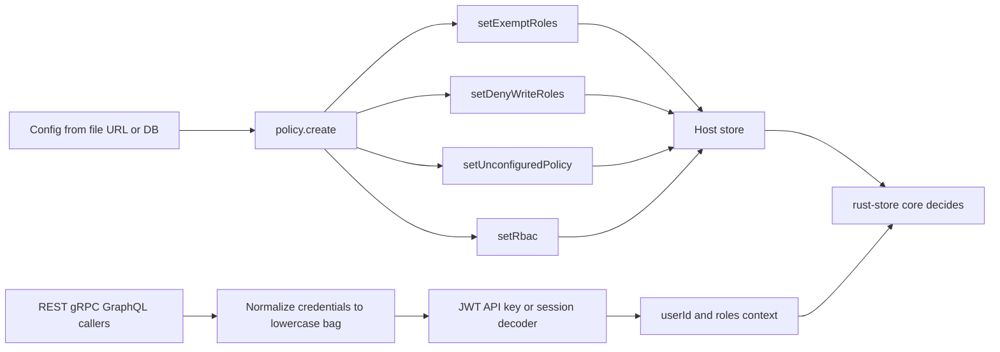

# store-rbac-bootstrap

**common-store 皮肤层的可选引导插件：它把一套 RBAC 策略装到宿主 store 上，再把各张皮的凭证变成同一个 `{userId, roles}` 上下文 —— 然后把每一个权限判决留给 core。**


- 两个同构运行时，版本都在 **0.2.3**：`store-rbac-bootstrap-node` 与 `store-rbac-bootstrap-py`。
- 四个宿主门面，三张皮，六条上下文钩子 —— 没有一行逐皮授权代码。
- 策略原样搬运给 rust-store；本包从不读取、也不解释它。

> English: [README.en.md](./README.en.md)

## 三扇门，三个版本的「谁在调用」

设想一个产品，把同一批表通过三扇门暴露出去：REST 给浏览器，GraphQL 给移动端，gRPC 给内部服务。再设想每扇门都长出了自己的授权胶水 —— 这里一个 token 解析器，那里一个 metadata 读取器，别处又有一段 cookie 查找。同一个角色最后有三种拼法。一次策略变更，变成三个 PR、三次部署。事故复盘卡在一个没人能确定回答的问题上：这次调用走的是哪扇门，用的是哪一份身份逻辑？

不需要一场大故障，这笔税就会累积。它表现为四个宿主门面被以三种不同顺序调用，六条签名各不相同的上下文钩子，以及被复制进每一张新皮的凭证提取代码。这一段里的数字是结构性的，不是测出来的：3 张皮 × 2 个运行时 = 6 条钩子，4 个门面，4 个配置键，2 张可选参考表。

这个仓库只在边缘消除重复 —— 别处一概不碰。它安装策略。它产出身份。它不做判决。

## 它实际做什么

两个映射，刻意不多做一件：

1. **策略引导** —— 读一份 JSON 配置，校验它，然后按固定顺序调用宿主 store **既有的** RBAC 门面：`setExemptRoles`、`setDenyWriteRoles`、`setUnconfiguredPolicy`，最后 `setRbac`。可选地注册接入方自带的 schema 定义；不触发任何 DDL。
2. **身份适配** —— 把 JWT、API Key 或 cookie session 解码成 `{userId, roles}`，再把解码器包成每张皮所要求的那条钩子签名。

| 它做 | 它拒绝做 |
|---|---|
| 读引导配置，调用四个既有宿主门面 | 判定调用方能否读写某一行 |
| 把可选 schema 定义注册进宿主注册表 | 建表，或拥有业务 schema |
| 把 JWT / API Key / cookie session 解码成 `{userId, roles}` | 签发 token、存用户、认证任何人 |
| 填上 REST、GraphQL、gRPC 既有的六条上下文接缝 | 发明错误码、状态码或管理 API |

### 两个运行时，一份契约

| 运行时 | 包 | 安装 | 导入 | 最低版本 |
|---|---|---|---|---|
| Node | `store-rbac-bootstrap-node` | `npm i store-rbac-bootstrap-node` | `require('store-rbac-bootstrap-node')` | Node >= 18 |
| Python | `store-rbac-bootstrap-py` | `pip install store-rbac-bootstrap-py` | `import store_rbac_bootstrap` | Python >= 3.10 |

两者都是 **0.2.3**，实现同一份 [`spec/00-protocol.md`](./spec/00-protocol.md)。自有依赖只有 `jsonwebtoken ^9`（Node）与 `PyJWT >= 2.8`（Python）。宿主 store 声明为**可选 peer**（`nodejs-store >= 3.0.0` / `py-store >= 3.0.0`）—— 没有运行时依赖，因为 store 实例由接入方传入。

## 关键机制

### 1. 先装策略，碰 store 之前先校验

`policy.create(store, …)` 返回一个句柄，带两个方法。`start()` 跑一段刻意固定的序列：

1. 从选定的来源读配置（`file`、`url`、`db`，或你自己的函数）。读取失败原样传播。
2. 校验信封。顶层只允许四个键；未知键、非数组的 `exemptRoles`、或不在 `"open"` / `"closed"` 之内的 `unconfiguredPolicy`，都会在**任何门面调用之前**抛错 —— 坏配置不可能留下半应用状态。
3. 用同步且幂等的 `has` / `register` 注册生效的 `schemas` 集合。默认 `[]`，什么都不注册。
4. 按严格顺序应用四个门面，`setRbac` 放最后，让策略只有在周边清单就位后才生效。

`reload()` 先调 `setRbac(null)` —— 显式清除，不让陈旧授权幸存 —— 再重跑整段序列。调用是幂等的：注入参考 schema 时，第一次 `start()` 报 `{ registered: ['RbacRole', 'RbacGrant'], skipped: [] }`，第二次报 `{ registered: [], skipped: ['RbacRole', 'RbacGrant'] }`。插件不带 watcher，也不带定时器：何时 reload 由你决定。

schema 归属是解耦的。本包**不提供权威 RBAC schema**，也不提供业务 schema。`policy.schemas()` 返回两份*参考*定义 —— `RbacRole`（`__rbac_roles`）与 `RbacGrant`（`__rbac_grants`）—— 每次调用深拷贝。只有你注入时才用得上，且只用于 `register` 定义，从不用于建表。

### 2. 适配身份：一个 bag，两层，六种签名

一切被拆成与皮无关的**解码器**（`bag → ctx`），以及把解码器装进既有接缝的逐皮**适配器**。

bag 是一个扁平映射，凭证键均为小写；同一个头出现多次时，第一个字符串值胜出。每个适配器知道去哪儿找这个 bag：

| 皮 | Node 的 bag 来源 | Python 的 bag 来源 |
|---|---|---|
| store-api | `req.headers` | `request.headers` |
| store-grpc | `call.metadata`（支持 `getMap`、`forEach` 或迭代） | `invocation_metadata`（成对序列或带 `get` 的对象） |
| store-graphql | `{ request, serverContext }.request.headers` | `request.headers` |

三个解码器覆盖常见凭证风格。`identity.jwt` 校验 `HS256` / `HS384` / `HS512` 的签名与过期时间，默认映射 `sub` 与 `roles`。`identity.apiKey` 与 `identity.session` 把凭证库交给你的 `lookup` 回调，回调可以是异步的；未命中返回 `null`，不是空上下文。

签名跨皮不同，同一张皮的两个运行时也不同，所以工厂逐皮逐端适配：

| 皮 | Node 钩子 | Python 钩子 |
|---|---|---|
| store-api | `(req) => Promise<ctx \| null>` | `async (request) => ctx \| None` |
| store-grpc | `(metadata) => Promise<ctx \| null>` | `async (invocation_metadata) => ctx \| None` |
| store-graphql | `({ request, serverContext }) => Promise<ctx \| null>` | `async (request) => ctx \| None` |

未知皮名在构造时抛错。不存在「一套签名通用」。内置解码器永远产出 `ctx` 或严格的 `null` —— 绝不缺一个返回值，那会绕开该皮的显式清除。

### 3. 裁决留在 core

策略对象对本包是不透明的。校验只覆盖四键信封；共享语料把 `mode`、`grants`、`readFields`、`writeFields`、`ownerOnly`、`condition` 这类策略内容键列为插件逻辑中的禁词。对象原样交给 `setRbac`。

这正是重点。rust-store 拥有判决 —— 静态白名单、动态 RBAC 引擎、`creator` 伪角色、`ownerOnly` 行条件。本插件只拥有输入：一个真实的 `userId`，以及随它而来的角色。如果没有 `userId` 抵达上下文，core 的归属条件自然为假；插件从不猜、从不填默认身份、从不把缺失凭证变成匿名用户。

### 4. 错误：三种状态，不新增词汇

身份层恰好三种结果，两个运行时完全一致：

| 情形 | 插件行为 | 皮本来会做的 |
|---|---|---|
| 没有凭证 | 返回严格的 `null` / `None` | 显式清除上下文 |
| 有凭证但无效 | 抛普通 `Error` / `ValueError`，消息中文，**无 `ERR_` 前缀** | 映射为 401 或 `UNAUTHENTICATED` |
| `lookup` 抛出宿主权限类 | 原样传播 —— 不做 `instanceof` 检查，不包装 | 映射为 403 或 `PERMISSION_DENIED` |

裁决层有自己的三种状态，而本插件站在这条路径之外。写探测匹配不到行返回 `ERR_NOT_FOUND` —— 刻意不是权限错误，因为「已删除」和「不是你的」需要不同答案。行存在但不可触碰时，保留 core 的原始权限措辞，不重新包装。插件看不到查询结果，也就没有拦截点：皮映射什么，调用方就拿到什么，中间不加一个词。

## 跑起来

```bash
# Node
npm i store-rbac-bootstrap-node
npm i nodejs-store                  # 可选 peer，作为宿主 store 传入

# Python
pip install store-rbac-bootstrap-py
pip install py-store                # 可选 peer，作为宿主 store 传入
```

下面的 Node 片段对应 `node/test/policy.test.js`（T1）与 `node/test/identity.test.js`（T12）里的断言。装完即可直接运行；store 是一个内存记录器，不需要任何外部依赖。

```javascript
const jwt = require('jsonwebtoken');
const { policy, identity } = require('store-rbac-bootstrap-node');

const calls = [];
const store = {
  setRbac: (v) => calls.push(['setRbac', v]),
  setExemptRoles: (v) => calls.push(['setExemptRoles', v]),
  setDenyWriteRoles: (v) => calls.push(['setDenyWriteRoles', v]),
  setUnconfiguredPolicy: (v) => calls.push(['setUnconfiguredPolicy', v]),
};

(async () => {
  const config = {
    policy: { mode: 'overlay', roles: {}, grants: [] },
    exemptRoles: ['super_admin'],
    denyWriteRoles: ['guest'],
    unconfiguredPolicy: 'closed',
  };

  const handle = policy.create(store, { source: async () => config });
  await handle.start();
  console.log(calls.map(([name]) => name));
  // ['setExemptRoles', 'setDenyWriteRoles', 'setUnconfiguredPolicy', 'setRbac']

  const decode = identity.jwt({ secret: 'dev-secret-at-least-32-bytes-long!!' });
  const token = jwt.sign({ sub: 'u1', roles: ['editor'] }, 'dev-secret-at-least-32-bytes-long!!');
  console.log(await decode({ authorization: `Bearer ${token}` }));
  // { userId: 'u1', roles: ['editor'] }

  const restHook = identity.adapt('store-api', decode);
  // 把 restHook 接成 store-api 的 contextProvider
})();
```

Python 片段对应 `py/tests/test_policy.py`（T1）与 `py/tests/test_identity.py`（T12）。

```python
import asyncio
import jwt
from store_rbac_bootstrap import policy, identity


class Store:
    def __init__(self):
        self.calls = []

    def set_rbac(self, v):
        self.calls.append(("set_rbac", v))

    def set_exempt_roles(self, v):
        self.calls.append(("set_exempt_roles", v))

    def set_deny_write_roles(self, v):
        self.calls.append(("set_deny_write_roles", v))

    def set_unconfigured_policy(self, v):
        self.calls.append(("set_unconfigured_policy", v))


async def main():
    store = Store()
    config = {
        "policy": {"mode": "overlay", "roles": {}, "grants": []},
        "exemptRoles": ["super_admin"],
        "denyWriteRoles": ["guest"],
        "unconfiguredPolicy": "closed",
    }

    async def source():
        return config

    handle = policy.create(store, source)
    await handle.start()
    print([name for name, _ in store.calls])
    # ['set_exempt_roles', 'set_deny_write_roles', 'set_unconfigured_policy', 'set_rbac']

    decode = identity.jwt(secret="dev-secret-at-least-32-bytes-long!!")
    token = jwt.encode({"sub": "u1", "roles": ["editor"]}, "dev-secret-at-least-32-bytes-long!!", algorithm="HS256")
    print(await decode({"authorization": f"Bearer {token}"}))
    # {'userId': 'u1', 'roles': ['editor']}

    rest_hook = identity.adapt("store-api", decode)
    # 把 rest_hook 接成 store-api 的 context_provider


asyncio.run(main())
```

两个运行时各带同样 21 条镜像用例（T1–T21），外加 `conformance/cases.json` 里的共享语料；没有任何一端复制期望值。运行方式：`cd node && npm test`，以及 `cd py && pip install -e ".[dev]" && pytest`。

## 边界：什么时候不要用

- **它不是授权引擎。** 它不做权限判定，没有拒绝点，不构造权限错误。那是 rust-store 永久的工作。
- **它不是认证。** 它不注册用户、不签发 token、不校验密码、不拥有凭证库。JWT 只处理到签名与过期；API Key 与 session 交给你的 `lookup`。它从不决定谁能登录。
- **它不建表，也不定义业务 schema。** `schemas` 只把定义注册进宿主注册表；不跑 DDL，业务实体不在范围内。
- **它不带 watcher、定时器或策略管理面。** 何时调用 `reload()` 由你决定。既定的管理路径，是复用 store-api 在你定义 schema 上自动生成的 CRUD。
- **它不映射状态码。** 401 / 403 / `UNAUTHENTICATED` / `PERMISSION_DENIED` 属于皮既有的行为。
- **只有一张皮、一个身份源时，它没必要。** 几行胶水比一个新依赖便宜；当同一套策略要在多个面、两个运行时上成立时，这个包才回本。
- **首期排除项：** Go 系皮、Rust 版 `store-api`，以及两个运行时下的 `store-mcp`（5 条钩子）暂不在范围。「排除」不是「不支持」；锚点是 Go 生态成熟度与网关的第四个开关。

## 它在家族里的位置

它占据两个宿主 store 与三张协议皮之间的接缝，形态借自 [store-gateway](https://github.com/coenddt/store-gateway)：读配置，插进已经存在的接缝。

- [rust-store](https://github.com/coenddt/rust-store) —— 拥有权限判决的 core
- [nodejs-store](https://github.com/coenddt/nodejs-store) · [py-store](https://github.com/coenddt/py-store) —— 被调用门面的宿主 store
- [store-api](https://github.com/coenddt/store-api) · [store-graphql](https://github.com/coenddt/store-graphql) · [store-grpc](https://github.com/coenddt/store-grpc) —— 被填上上下文接缝的皮
- [store-mcp](https://github.com/coenddt/store-mcp) —— MCP 皮，本阶段排除

## 一张图



策略从左边进来一次。身份从右边进来一次。每一条本可以是逐皮授权检查的箭头，最后都落在同一个 core。
